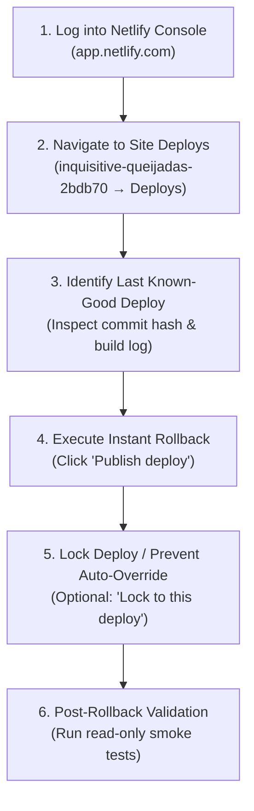
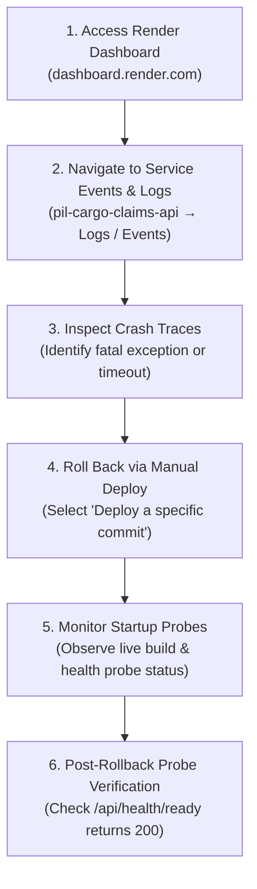
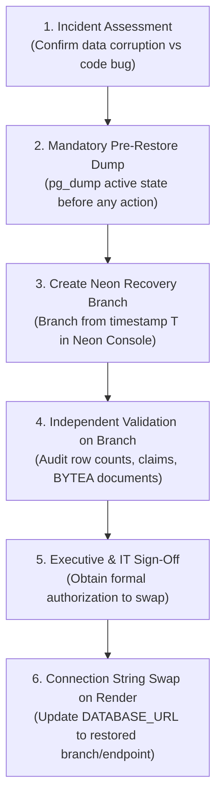

# Phase 9.7 – Cloud Recovery Runbook
**Project:** Pacific International Lines (PIL) Cargo Claim & Survey Management System  
**Document Type:** Cloud Disaster Recovery, Rollback, and Emergency Operations Runbook  
**Target Architecture:**  
- **Frontend Host:** Netlify Edge CDN (`https://inquisitive-queijadas-2bdb70.netlify.app`)
- **Backend Host:** Render Web Service (`https://pil-cargo-claims-api.onrender.com`)
- **Database Host:** Neon Serverless PostgreSQL (`ep-...neon.tech`)  
**Date:** 2026-11-19  
**Status:** ⚠️ **OPERATIONAL RUNBOOK (Cloud Procedures Require Dashboard Access & PIL IT Verification)**

---

> [!IMPORTANT]
> **Audit & Safety Boundary:**  
> This runbook defines manual and automated recovery protocols for the live Cloud deployment.  
> In accordance with strict audit safety rules:
> - Do **not** execute commands or modify cloud settings without explicit incident authorization from PIL IT leadership.
> - Do **not** create test records in the production database.
> - Never print, export, or expose credentials or connection strings.
> - **Neon PITR status, plan tier, and retention window are NOT VERIFIED** and must be audited in the Neon Console before relying on point-in-time restores.

---

## Section A: Netlify Frontend Recovery

### A.1 Overview & Architecture
The frontend is a single-page application (SPA) built with React 19, TypeScript, and Vite. Static assets are served from Netlify Edge CDN.
- **Root URL:** `https://inquisitive-queijadas-2bdb70.netlify.app`
- **Reverse-Proxy Rule:** `client/public/_redirects` forces `/api/*` requests to proxy to Render:
  ```
  /api/*  https://pil-cargo-claims-api.onrender.com/api/:splat  200!
  /*      /index.html  200
  ```
- **Current Edge State:** Netlify Edge is **active and unlocked** (`site_id=152b8715-1ac1-4657-8a0d-cb775f9f56ac`), returning `HTTP 200 OK` and serving production SPA assets (`index-CNo4QX0v.js`).

### A.2 When to Trigger Frontend Rollback
- Deploying a new Git commit causes a white-screen crash, bundle syntax error, or client-side runtime exception.
- Netlify `_redirects` proxy ceases forwarding traffic to Render.
- Critical UI regression prevents claim creation, survey condition recording, or document previews.

### A.3 Step-by-Step Netlify Rollback Procedure



1. **Step 1: Access Netlify Web Console**
   - Log into `https://app.netlify.com`.
   - Select the PIL Cargo Claims site: `inquisitive-queijadas-2bdb70`.
2. **Step 2: Inspect Deployment Log History**
   - Navigate to the **Deploys** tab (`https://app.netlify.com/sites/inquisitive-queijadas-2bdb70/deploys`).
   - Review recent deployment statuses:
     - 🟢 **Published:** The current live deploy.
     - 🔴 **Failed:** Deploys that failed compilation (`npm run build:client`).
     - ⚪ **Canceled:** Aborted runs.
   - Click on the failed or defective deploy to inspect the build log for Vite / TypeScript compiler errors.
3. **Step 3: Select Last Known-Good Deployment**
   - Find the previous successfully published deployment associated with an audited milestone commit (e.g., `baefb00`).
   - Click on the deployment entry to open its detail view.
4. **Step 4: Execute Instant Rollback (Publish Deploy)**
   - Click the **"Publish deploy"** button.
   - *Timing:* Netlify Edge CDN updates atomically in $< 1$ second globally across all edge locations.
5. **Step 5: Lock Deploy (Prevent Automatic Git Trigger Overrides)**
   - If an ongoing Git push issue exists on `main`, click **"Lock to this deploy"** in the deployment header. This prevents subsequent incoming Git webhooks from replacing the restored version until unlocked by an engineer.
6. **Step 6: Verify Proxy & Frontend Accessibility**
   - Test frontend availability: `GET https://inquisitive-queijadas-2bdb70.netlify.app/`
   - Test proxy routing: `GET https://inquisitive-queijadas-2bdb70.netlify.app/api/health/ready`
   - *Note on HTTP 401:* If Site Protection / Edge Access remains enabled, testing must be performed within an authenticated Netlify team session or browser authenticated with the edge access gate. **Do not disable Site Protection without PIL IT approval.**

---

## Section B: Render Backend Recovery

### B.1 Overview & Architecture
The backend is an Express/TypeScript REST service deployed on Render as a Web Service.
- **Service Identifier:** `pil-cargo-claims-api`
- **Live URL:** `https://pil-cargo-claims-api.onrender.com`
- **Runtime Command:** `tsx server/src/index.ts` (port dynamically bound via `process.env.PORT`)
- **Health Probes:**
  - Liveness: `/api/health/live`
  - Readiness (DB Pool Check): `/api/health/ready`
  - Combined Health: `/api/health`

### B.2 When to Trigger Backend Rollback
- New backend release crashes upon startup or throws unhandled promise rejections.
- Health probe `/api/health/ready` consistently reports `database: "disconnected"` due to a connection pool exhaustion or configuration bug.
- Critical REST API defect breaks financial tallies, authentication tokens, or document uploads.

### B.3 Step-by-Step Render Rollback Procedure



1. **Step 1: Access Render Dashboard**
   - Log into `https://dashboard.render.com`.
   - Select the web service: `pil-cargo-claims-api`.
2. **Step 2: Inspect Deployment Events & Runtime Logs**
   - Click **Logs** tab: Inspect stdout/stderr for startup exceptions, fatal `JWT_SECRET` errors, or PostgreSQL connection errors.
   - Click **Events** tab: Check deployment lifecycle states (`Deploy started`, `Build succeeded`, `Health check failed`).
3. **Step 3: Trigger Rollback to Known-Good Commit**
   - Click the **Manual Deploy** dropdown in the top right.
   - Select **"Deploy a specific commit..."**.
   - Input the short commit hash of the last known-good milestone (e.g., `baefb00`).
   - Click **"Deploy"**.
4. **Step 4: Monitor Zero-Downtime Rollout**
   - Render will build the image from the specified commit.
   - Render’s health probe will query `/api/health` or `/api/health/live`.
   - Once the probe returns `HTTP 200`, Render shifts routing to the restored container and terminates the defective instance.
5. **Step 5: Verify Backend Health & Neon Database Connectivity**
   - Execute read-only curl/browser check:
     ```bash
     curl -s https://pil-cargo-claims-api.onrender.com/api/health/ready
     ```
   - Verify response is exactly:
     `{"status":"ready","database":"connected","timestamp":"..."}`
   - Verify uptime and environment:
     ```bash
     curl -s https://pil-cargo-claims-api.onrender.com/api/health
     ```

---

## Section C: Neon PostgreSQL Recovery

### C.1 Critical Notice on Neon Disaster Recovery
> [!WARNING]
> **NEON PITR IS AN UNVERIFIED ASSUMPTION.**  
> In Phase 9.5, continuous point-in-time recovery was assumed. **This assumption has not been validated.**  
> - **Free Tier Limitation:** Neon Free tier limits branch history / time travel to **24 hours**. Compute endpoints automatically suspend after 5 minutes of inactivity.  
> - **Launch/Scale Tiers:** Support configurable 7-day or 30-day PITR retention.  
> **Mandatory Action:** PIL IT must log into `https://console.neon.tech`, review the project settings, and confirm the active subscription tier and retention window before relying on PITR for production disaster recovery.

### C.2 Distinction: Code Rollback vs Database Recovery
- **Code Rollback (Safe & Reversible):** Reverting frontend/backend commits restores previous application logic without altering rows or database state.
- **Database Restore (Destructive & Irreversible without Pre-Backup):** Restoring a database snapshot or dropping tables overwrites or deletes real claim records, survey appointment logs, uploaded binary documents (`attachment_data`), and audit trails. **Never restore a database to fix an application code bug.**

### C.3 Neon Branch-Based Recovery Procedure (Zero-Risk Staging)
Neon provides copy-on-write database branching. This enables recovering data to a test branch **without touching production**.



#### Step 1: Mandatory Incident Assessment & Freeze
- Immediately identify the exact timestamp $T_{\text{corrupt}}$ when the data corruption or schema issue occurred.
- If data corruption is actively continuing, temporarily pause the backend web service on Render to freeze all incoming transactions.

#### Step 2: Mandatory Pre-Restore Snapshot
Before taking any restore action, execute a full logical backup of the current database state (preserving evidence and forensic logs):
```bash
# Using pg_dump with the production DATABASE_URL
pg_dump "$DATABASE_URL" --format=custom --compress=9 --file="emergency_pre_restore_$(date +%Y%m%d_%H%M%S).pgdump"
```
*Note: Never execute a database restore without a pre-restore snapshot.*

#### Step 3: Create an Isolated Recovery Branch in Neon Console
1. Log into `https://console.neon.tech`.
2. Select the PIL Cargo Claims project.
3. Navigate to **Branches** → Click **"Create Branch"**.
4. In the branch dialog:
   - Name: `recovery_branch_YYYYMMDD`
   - Parent Branch: `main` (or production branch)
   - Point in Time: Select **"Past point in time"** and enter a timestamp 5 minutes prior to $T_{\text{corrupt}}$.
5. Click **"Create Branch"**.
6. Neon instantly creates an isolated database copy at that exact point in time using copy-on-write storage. **Production data is 100% untouched.**

#### Step 4: Validate Data Integrity on the Recovery Branch
1. Obtain the connection string for `recovery_branch_YYYYMMDD` from the Neon console.
2. Connect to the recovery branch using a temporary read-only connection or test harness:
   ```sql
   -- Verify key table record counts
   SELECT 'claims' AS table_name, COUNT(*) FROM claims
   UNION ALL SELECT 'surveys', COUNT(*) FROM surveys
   UNION ALL SELECT 'users', COUNT(*) FROM users
   UNION ALL SELECT 'attachment_metadata', COUNT(*) FROM attachment_metadata
   UNION ALL SELECT 'attachment_data (BYTEA)', COUNT(*) FROM attachment_data
   UNION ALL SELECT 'audit_trail', COUNT(*) FROM audit_trail;
   ```
3. Audit the specific claims, surveys, or tallies affected by the incident to verify that records are complete and intact.

#### Step 5: Switch Production Endpoint (Requires PIL IT Sign-Off)
Once data integrity is confirmed on the recovery branch:
1. Obtain formal sign-off from PIL Marine Insurance and IT Management.
2. In the Render Dashboard (`pil-cargo-claims-api` → **Environment**):
   - Update `DATABASE_URL` with the restored branch connection string.
   - Click **Save Changes**.
3. Render automatically restarts the backend service with zero downtime, connecting all incoming traffic to the restored database state.
4. Verify backend health: `GET https://pil-cargo-claims-api.onrender.com/api/health/ready` reports `database: "connected"`.

---

## Section D: Incident Recovery Decision Matrix

| Incident Scenario | Primary Symptoms | Root Cause Category | Recovery Protocol | Required Authorization | Post-Recovery Validation | Escalation Contact |
|---|---|---|---|---|---|---|
| **Frontend Runtime Failure** | Blank white screen on Netlify; console errors (`Uncaught TypeError`); assets 404 | Frontend Build / Bundle Regression | **Section A:** Netlify Web Console → `Deploys` → Select previous deploy → Click `Publish deploy`. | Lead Frontend Engineer | Check root URL loads login UI; verify JS bundle loads without console errors. | Frontend Lead |
| **API Proxy Routing Blockage** | Frontend loads, but all `/api/*` calls fail with 404 or connection error | Netlify `_redirects` misconfiguration | **Section A:** Republish previous Netlify deploy. Verify `_redirects` contains `/api/* https://pil-cargo-claims-api.onrender.com/api/:splat 200!`. | Lead Engineer | Curl `https://inquisitive-queijadas-2bdb70.netlify.app/api/health/live` → expect 200 `status: ok`. | Cloud DevOps Lead |
| **Backend Crash / Boot Failure** | Render returns 502 Bad Gateway; `/api/health` unreachable; logs show fatal error | Backend Code Regression / Missing Env Var | **Section B:** Render Dashboard → `Manual Deploy` → `Deploy a specific commit` (last known-good hash). Verify `JWT_SECRET` and `OTP_SALT`. | Lead Backend Engineer | Query `/api/health/live` and `/api/health/ready`. | Backend Lead |
| **PostgreSQL Pool Disconnect** | `/api/health/ready` returns `database: "disconnected"` or 503; API endpoints return 500 | Neon connection pool exhausted; SSL handshake failure | Check Neon status; verify `max: 20` pool limit; restart Render service via `Manual Deploy → Clear build cache & deploy`. | Database Administrator | Query `/api/health/ready` until `database: "connected"`. | Lead DBA / Cloud DevOps |
| **Accidental Data Deletion / Corruption** | Missing claim rows, corrupted survey records, or missing financial tallies | Defective migration, accidental deletion script | **Section C:** Freeze writes; perform mandatory emergency dump; create Neon time-travel branch at $T - 5\text{min}$; validate data; swap `DATABASE_URL`. | **PIL IT Director & Marine Insurance Lead** | Audit row counts across all 6 core tables; run smoke tests. | PIL IT Director |
| **Netlify Edge Access 401 Lockout** | Public users receive 401 Unauthorized redirecting to `app.netlify.com/edge-access` | Netlify Visitor Access Control / Site Protection enabled | **Section A & PIL IT Gate:** In Netlify console → `Access management` → switch Visitor access control to "Public" (requires company approval). | **PIL IT Sponsor / Management** | Curl root URL without cookies; expect 200 HTML with `<div id="root">`. | PIL Project Sponsor |

---

## Section E: Post-Recovery Smoke Test Protocol

> [!CAUTION]
> **READ-ONLY EXECUTION RULE:**  
> During production post-recovery validation, **DO NOT create dummy or test claims in the production database**.  
> Execute read queries, verify record existence, test authentication tokens, and validate health probes only.  
> If write validation (e.g. claim creation) is required, perform it against an isolated staging branch or local `pil_claims_test_db`.

Execute the following 10 verification steps after any rollback or recovery action:

```
┌────────────────────────────────────────────────────────────────────────┐
│               POST-RECOVERY VERIFICATION CHECKLIST                     │
├────────────────────────────────────────────────────────────────────────┤
│ [ ] TEST 1: Backend Liveness Probe                                     │
│     curl -s https://pil-cargo-claims-api.onrender.com/api/health/live  │
│     Expected: HTTP 200 {"status":"ok"}                                 │
│                                                                        │
│ [ ] TEST 2: Neon Database Readiness Probe                              │
│     curl -s https://pil-cargo-claims-api.onrender.com/api/health/ready │
│     Expected: HTTP 200 {"status":"ready","database":"connected"}       │
│                                                                        │
│ [ ] TEST 3: Netlify Proxy Forwarding                                   │
│     curl -s https://inquisitive-queijadas-2bdb70.netlify.app/api/health│
│     Expected: HTTP 200 {"status":"healthy","environment":"production"} │
│     (Note: Requires edge session if Site Protection is active)         │
│                                                                        │
│ [ ] TEST 4: Frontend Asset Integrity                                   │
│     Navigate to frontend root in browser (incognito mode).             │
│     Expected: PIL Login page renders; no red console exceptions.       │
│                                                                        │
│ [ ] TEST 5: OpenAPI Schema Accessibility                               │
│     curl -s https://pil-cargo-claims-api.onrender.com/api/docs/openapi.json
│     Expected: HTTP 200 with valid OpenAPI 3.0 specification.           │
│                                                                        │
│ [ ] TEST 6: CORS Preflight Allowlist                                   │
│     curl -I -X OPTIONS https://pil-cargo-claims-api.onrender.com/api/health \
│          -H "Origin: https://inquisitive-queijadas-2bdb70.netlify.app" │
│     Expected: HTTP 204 with Access-Control-Allow-Origin header.        │
│                                                                        │
│ [ ] TEST 7: Authentication & Session Token Issuance                    │
│     Log in as an existing administrator or MID user via the UI.        │
│     Expected: Successful authentication, JWT issued, redirect to       │
│     Dashboard, sidebar renders appropriate role capabilities.          │
│                                                                        │
│ [ ] TEST 8: Role-Based Access Control (RBAC) Boundaries               │
│     Log in as agency user: verify MID-only navigation tabs are hidden. │
│     Attempt direct access to /users: verify 403 or redirect to home.   │
│                                                                        │
│ [ ] TEST 9: Claims & Financial Tally Read Inspection                   │
│     Navigate to /claims: verify existing claims list loads cleanly.     │
│     Inspect Claim Detail: verify Frankfurter exchange rates and tallies│
│     render correctly without NaN or calculation errors.                │
│                                                                        │
│ [ ] TEST 10: BYTEA Document Inspection                                 │
│     Open an existing claim with attachments. Click document preview.    │
│     Expected: Authenticated streaming modal displays document inline    │
│     with valid MIME type and SHA-256 integrity check passed.           │
└────────────────────────────────────────────────────────────────────────┘
```
